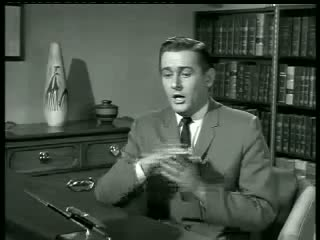

# DubTool

[](https://github.com/LeftInWalmart/dubtool/actions/workflows/tests.yml)
[](LICENSE)
[](https://www.python.org/downloads/release/python-3110/)

Localize a video — or just a script — into another language **using each character's own
voice**. Free, MIT licensed, runs on your machine: no uploads, no accounts, no per-minute
fees.



```powershell
dub.py run   "S01E01.mkv"  --lang es            # a finished cut
dub.py batch "lines.csv"   --voices cast/       # or a script, no video needed
```

Point it at `S01E01.mkv`, name a language, get `S01E01.es.mp4` with the English audio
replaced by Spanish speech that still sounds like the original actors' voices — music,
gunfire and laugh track untouched. Animation and game studios can skip the video entirely
and hand it a CSV of lines plus a recording per character.

A real run is checked in: `demo/excerpt.mp4` is 100 s of a public-domain *Mr. Ed* episode
(1961, 320×240, 63 kbps — a deliberately hostile source), `demo/media/demo-es.mp4` is the
tool's Spanish dub of it, and `demo/media/line*.mp3` are the A/B pairs of two consecutive
lines. `demo/excerpt.es.xtts.mp4`, if present locally, is the older XTTS render.

```
episode.mkv
   │
   ├─ 1  extract audio ────────────────────────── master.wav 44.1k
   ├─ 2  demucs: music/effects out, then gate ─── vocals.wav + novocals.wav → bed.wav
   ├─ 3  faster-whisper: transcript + timings ─── asr.json
   ├─ 4  diarization + per-character voice clips ─ speakers.json + refs/*.wav
   ├─ 5  LLM translation, line by line ─────────── translate.<lang>.json
   ├─ 6  clone each voice, say the new line ────── dub/00042.wav ...
   ├─ 7  fit each line into its original slot ──── dub_track.wav
   └─ 8  mix over bed, mux with the video ──────── S01E01.es.mp4
```

## Engines and licences

This matters if you plan to sell what comes out.

| `--tts` | weights | languages | speed (CPU) | sell the dubs? |
|---|---|---|---|---|
| `chatterbox` (default) | **MIT** | 23 | ~45–60 s per line | **yes** |
| `xtts` | Coqui Public Model License | 17 | ~14 s per line | no — non-commercial |
| `elevenlabs` | hosted, paid | 29+ | seconds | yes, but you rent it per minute |

Coqui XTTS-v2 is the better-known voice clone and it is faster, but its licence says
*"only non-commercial use of a machine learning model and its outputs"*, and Coqui no longer
exists to sell you another one. Fine-tuning on its outputs does not change that. So the
default is Chatterbox (Resemble AI, MIT), which stays free to use commercially. The full table of
model licences is in [THIRD-PARTY-LICENSES.md](THIRD-PARTY-LICENSES.md).


## Setup (once)

Windows (PowerShell), from the folder you cloned into:

```powershell
powershell -ExecutionPolicy Bypass -File setup.ps1
```

That creates `.venv` with Python 3.11 (torch publishes no wheels for 3.13+ yet, so a
brand-new system Python will fail here) and installs everything. Add `-Cuda` for an
NVIDIA GPU, `-Extras` for pyannote diarization.

Then the voice engine, which needs its own environment because its torch pin fights ours:

```powershell
powershell -ExecutionPolicy Bypass -File scripts\setup_chatterbox.ps1
```

`ffmpeg` comes from the bundled `imageio-ffmpeg` wheel unless one is already on PATH.
macOS/Linux: `uv venv -p 3.11 .venv && .venv/bin/pip install -r requirements.txt` does the
same job; nothing in the pipeline is Windows-specific.

Check the machine before spending an evening on a render:

```powershell
.\.venv\Scripts\python.exe dub.py doctor
```

Keys, all optional:

| env var | used for | without it |
|---|---|---|
| `OPENROUTER_API_KEY` | context-aware translation of the whole script | falls back to Google Translate, line by line |
| `HF_TOKEN` | pyannote diarization (best speaker splits) | ECAPA embeddings (fine) |
| `ELEVENLABS_API_KEY` | languages no local engine speaks | local engines only |

The Google fallback translates each line alone with no context, so short lines get mangled
(`Fine.` → `Bußgeld.`). An OpenRouter key with a little credit is the real fix; a capped key
returns `403 Key limit exceeded` and the tool drops to Google automatically.

The models download once, on first use (~10 GB total, ~4 GB for the voice engine alone), into
`.cache\` next to the code. Point `DUB_CACHE` elsewhere if that drive is small.

## Use

```powershell
$py = ".\.venv\Scripts\python.exe"

# what is this show, who talks, how much
& $py dub.py analyze "D:\Shows\S01E01.mkv"

# dub one episode into Spanish
& $py dub.py run "D:\Shows\S01E01.mkv" --lang es

# a whole season, in parallel-proof batch
& $py dub.py run "D:\Shows\Season 1" --lang fr --out-dir "D:\Dubbed"

# a language no local engine has (Thai, Ukrainian, Vietnamese, ...)
$env:ELEVENLABS_API_KEY="..."
& $py dub.py run "D:\Shows\S01E01.mkv" --lang th --tts elevenlabs
```

Named characters translate better and stay consistent:

```json
{ "spk00": "Walter", "spk01": "Jesse", "spk02": "Skyler" }
```

```powershell
& $py dub.py run episode.mkv --lang de --cast cast.json
```

Speaker ids come from `analyze` (or `dubwork\<episode>\speakers.json`).

Want to try it without a real episode? This builds a 28 s two-character test
clip with Windows' own TTS voices and a music bed:

```powershell
& $py scripts\make_test_clip.py
& $py dub.py run _smoke\test_episode.mkv --lang es --whisper tiny
```

## Dubbing a script (animation, games)

Most animation and game work does not arrive as a finished mix — it arrives as a
list of lines and a recording per character. That mode skips demucs, whisper and
diarization completely: nothing to separate, nothing to transcribe, nothing to
guess.

```powershell
& $py dub.py batch cutscene-lines.csv --lang ja --voices "D:\Project\cast"
```

`cast\` holds one reference recording per character, named after the character:

```
cutscene-lines.csv      cast\
 id,character,text       wilbur.wav
 001,Wilbur,"Mmm, food."  lawyer.wav
 002,Lawyer,"Now then."   judge.wav
```

You get `cutscene-lines.ja\` with `001.ja.wav`, `002.ja.wav`, … plus
`lines.ja.csv` (source, translation, duration, file) and `lines.ja.json`. The
CSV header is optional — `id,character,text` is assumed — and an optional fourth
`audio` column makes each dub line fit the length of its original recording,
which is what a game engine expects when it swaps one clip for another.

`--voice me.wav` uses a single reference for every character; `cast\default.wav`
is the fallback for names with no file of their own. See `demo/lines.example.csv`
and `demo/cast/` for a working pair.

## What "the original voice" means

For every speaker the tool cuts a 4–20 s clean reference clip out of that
character's own dialogue (`dubwork\<episode>\refs\spk00.wav`) and gives it to a
voice-cloning TTS. It is zero-shot cloning of that specific take — the timbre
and delivery of the character, not a stock voice actor. It is not a perfect
reconstruction of the actor's voice; ~5 s of clean speech is the ceiling.

## Languages

- **Chatterbox** (local, MIT, 23): `ar da de el en es fi fr he hi it ja ko ms nl no pl pt ru sv sw tr zh`
- **XTTS v2** (local, non-commercial, 17): `en es fr de it pt pl tr ru nl cs ar zh-cn hu ja ko hi`
- **ElevenLabs** (`--tts elevenlabs`, paid, 29 languages): everything else, plus
  `uk th vi id ro bg sk hr ta fil`
- `--tts auto` picks for you (Chatterbox when installed); any wrong choice fails with the
  supported list.

## Cost of a 45-minute episode

| stage | CPU only | RTX 3060-class |
|---|---|---|
| demucs | 20–40 min | 2 min |
| whisper large-v3 | 20–50 min | 2 min |
| diarization | 2–5 min | 1 min |
| translate (LLM) | ~1 min, pennies | same |
| chatterbox (~400 lines) | 4–7 h | ~15–25 min (est.) |
| xtts (~400 lines) | 1–2 h | 5–10 min |
| **total (chatterbox)** | **5–8 h** | **~25 min (est.)** |

Chatterbox is the slower engine: measured here at **~32 s per line** (real-time factor ~10x) on a
12-core laptop CPU, against ~14 s for XTTS. On a laptop that is an overnight job, not a coffee
break - a GPU is worth it. Its speaking rate also varies line to line: some clauses come out barely
longer than the original, others 1.5-2x over, which the fitter compresses or clips.

### Going faster (measured, not guessed)

The voice stage dominates: on the 100 s demo it was **795 s of 824 s** (96 %). The one lever that
scales is a GPU. On CPU, more workers do **not** help much — this laptop (12 logical cores) is
memory-bandwidth bound, not core bound:

| `--jobs` | 12 lines | speed-up |
|---|---|---|
| 1 | 371 s (31 s/line) | 1.00× |
| 2 | 315 s (26 s/line) | 1.18× |
| 4 | 360 s (30 s/line) | 1.03× |
| 6 | 479 s (40 s/line) | 0.77× |

The flag still exists (`--jobs N`, `--jobs 0` = one per two cores, capped at 8) and is worth trying
before you buy hardware — a server with more memory channels, or a GPU box, behaves differently. Each
worker holds its own copy of the model (~1.2 GB RAM). It never changes the audio: lines are
independent and the mix stage still places them by timestamp.

If it is still too slow, the honest fixes are, in order: run it on a GPU (a used 8–12 GB card turns
hours into minutes), or switch the engine (`--tts xtts` is ~2× faster but its weights are
non-commercial, so that trade is not open to you). Buckle up, or buy a graphics card.

Disk: ~10 GB for the models (cached in `.cache\`, keep `DUB_CACHE` on a big
drive), plus a few hundred MB of scratch per episode.

Re-runs are cheap: every stage is cached in `dubwork\<episode>\state.json` and
only re-runs when its inputs or settings change (`--force` to ignore).

## Output

```
S01E01.es.mp4        dubbed video (video stream untouched)
dubwork\S01E01\  S01E01.es.srt      translated subtitles (same timings)
  report.json        speakers, line-by-line original + dub, timings, model used
  analyze.json       (after `analyze`)
  master.wav vocals.wav bed.wav asr.json speakers.json translate.es.json
  refs\spk00.wav     the voice reference used per character
  dub\00042.wav      one audio file per dubbed line
```

## Flags worth knowing

| flag | why |
|---|---|
| `--whisper small` | 4× faster transcript, worse on quiet dialogue |
| `--diarize single` | one narrator voice for everything (audiobook-ish content) |
| `--separate none` | skip demucs; **loses music and effects** — only for testing |
| `--translate none` | re-voice in the source language (voice-clone test) |
| `--keep-original-audio` | keep the original track as a 2nd audio stream |
| `--no-loudnorm` | no loudness normalisation on the final mix |
| `--device cuda` | force the GPU |

## Honest limits

- **No lip sync.** Lines are placed at their original start time and time-stretched
  by at most 1.4× (`atempo`); a line whose translation is far longer than the
  original is cut off at the next line's start instead of being pushed later, so
  the track never slides away from the picture. Real lip sync is a different
  (much bigger) project.
- **Clipped tails.** A translation that needs more than 1.4× the original time
  loses its last words. Real dubbing solves this by rewriting the script shorter
  ("dubtitles"); this tool does not rewrite.
- **Singing is removed** by demucs, together with everything else in the vocal
  stem — musical episodes will lose their songs.
- **Overlapping dialogue** sums into the same second (up to 0.25 s of it) instead
  of being ducked properly — two characters can talk over each other for a beat.
- **Very short speakers** (a character with 3 lines) clone poorly.
- **Speaker count** is detected, not named; two similar voices can collapse into
  one character (use `--diarize pyannote` + `HF_TOKEN` to reduce that).
- **Long episodes on CPU are slow.** That's the models, not the code.

## Troubleshooting

| symptom | fix |
|---|---|
| `torch` won't install | you're on Python 3.14 — run `setup.ps1`, don't pip install into system Python |
| `torchcodec` / `torchaudio` ImportError | torch >= 2.9 needs `torchcodec` + system FFmpeg for audio IO; stay on the pinned `torch<2.9` in `requirements.txt` |
| `ffmpeg not found` | `winget install --id Gyan.FFmpeg -e` or `pip install imageio-ffmpeg` |
| voice sounds wrong / generic | check `refs\spk00.wav` — if it's noisy or has music, `--separate demucs` is not running |
| characters mixed up | cut speaker count by using `--cast` ids from `analyze`, or install pyannote + `HF_TOKEN` |
| dub sounds rushed | the script needs more time than the original took; paste a tighter translation into `dubwork\<show>\translate.<lang>.json` and re-run |
| a line gets cut off mid-word | its translation is >40 % longer than the original; same fix, or lower `fit_audio(max_rate=…)` in `dubkit\ff.py` and accept a slower read |
| runs out of disk | `setx DUB_CACHE D:\dubcache` |
| chatterbox prints `forcing EOS token, long_tail=True` | it sometimes rambles after the sentence; the fitter trims and cuts it, but listen to that line's `dubwork\<show>\dub\NNNNN.wav` and re-run with `--force` if it ends in noise |
| the 1.9 GB XTTS download stalls | some links drop long single responses; run `.\.venv\Scripts\python.exe scripts\prefetch_xtts.py` (100 MB chunks, sha256-checked) and start again |
